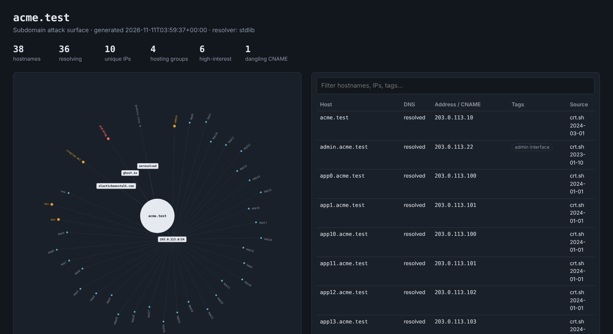

# web-recon-toolkit

Two small, dependency-light Python tools for web reconnaissance during authorised security assessments and coursework.

| Tool | Purpose |
|------|---------|
| [`dirscan.py`](dirscan.py) | Directory / endpoint brute forcing with status filtering, soft-404 detection and technology fingerprinting |
| [`subenum.py`](subenum.py) | Subdomain enumeration from certificate transparency + DNS, with an interactive attack-surface map |



> **Authorised use only.** Run these tools only against systems you own or have explicit written permission to test. Unauthorised scanning may be illegal. You are responsible for how you use them.

## Install

```bash
git clone https://github.com/<you>/web-recon-toolkit.git
cd web-recon-toolkit
python -m venv .venv && source .venv/bin/activate   # Windows: .venv\Scripts\activate
pip install -r requirements.txt
```

Python 3.9+. `subenum.py` falls back to the OS resolver if `dnspython` is missing, but CNAME-chain and dangling-record detection need it.

## dirscan

```bash
python dirscan.py https://target.example -w wordlists/dirs.txt -x php,bak -t 30 -o results.json
```

| Option | Description |
|--------|-------------|
| `-w` | Wordlist (required) |
| `-x php,bak` | Also try each word with these extensions |
| `-s 200,403` / `-e 403` | Status codes to show / hide |
| `--hide-length N,M` | Hide responses with these body sizes |
| `-t`, `--delay`, `--timeout` | Concurrency and pacing. Use a delay and fewer threads on fragile targets |
| `-H "Cookie: a=b"` | Custom header (repeatable) |
| `--follow`, `-k`, `--dirs` | Follow redirects, skip TLS verification, also try `word/` |
| `-o file.json` | Save results and fingerprint |

**How it works**
- **Soft-404 detection:** before scanning, it requests random paths to learn what "not found" looks like, then drops matching responses.
- **Fingerprinting:** it inspects headers, cookie names, home-page markers and the server's own 404 page, and lists missing security headers.

## subenum

```bash
python subenum.py example.com -w wordlists/subdomains.txt -t 50 -o example
# -> example.json, example.html
```

- Pulls names from **crt.sh**, optionally adds DNS brute force (`-w`), resolves A/AAAA/CNAME.
- Detects **wildcard DNS** and discards brute-force false positives.
- Flags **dangling CNAMEs** to takeover-prone services. These are *candidates* to verify manually, not confirmed takeovers.
- Tags high-interest names (`admin`, `staging`, `vpn`, `jenkins`, ...).
- The HTML report is self-contained (no external assets) with a radial map grouped by hosting provider / IP block, plus a filterable table. See [`examples/`](examples/) (invented data).

crt.sh is a free community service and is sometimes slow or rate-limited; the tool retries with backoff. Use `--no-crt` to skip it.

## Tests

```bash
pip install pytest
pytest
```

Tests use mocked DNS and crt.sh data, so they run offline.

## Limitations / ideas

- No recursion in `dirscan`; no HTTP probing of discovered subdomains yet.
- Only crt.sh as a passive source. More (VirusTotal, SecurityTrails, ...) would improve coverage.
- Threads rather than asyncio. `httpx.AsyncClient` would scale further.

## License

MIT. See [LICENSE](LICENSE).
